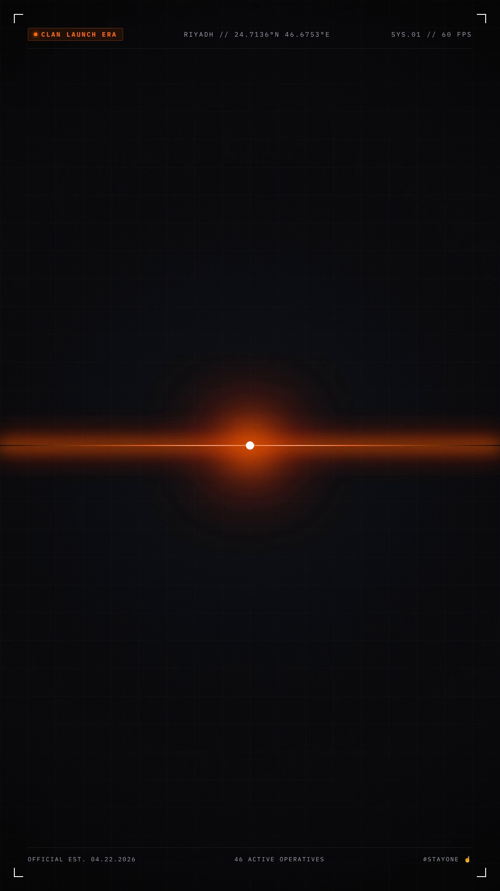
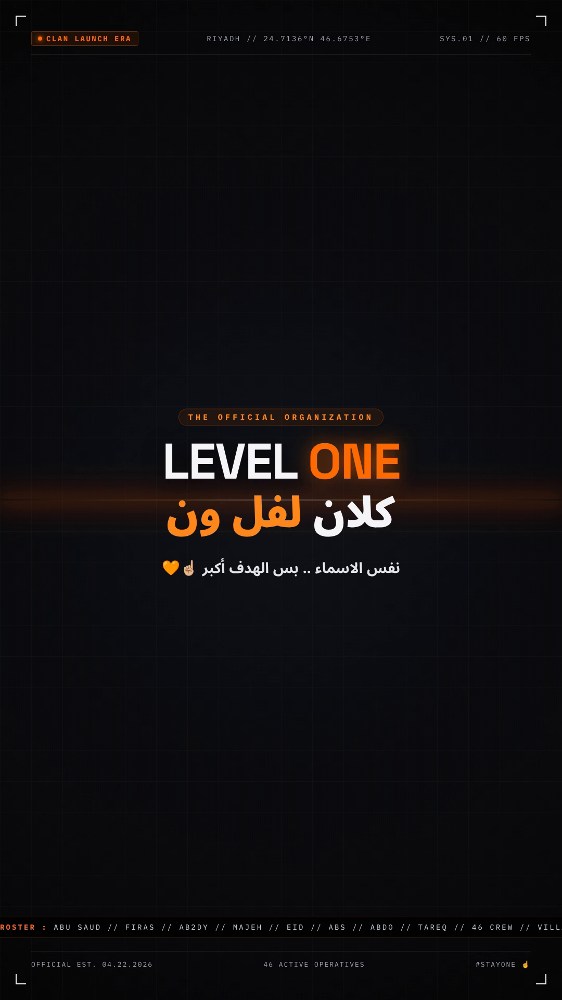
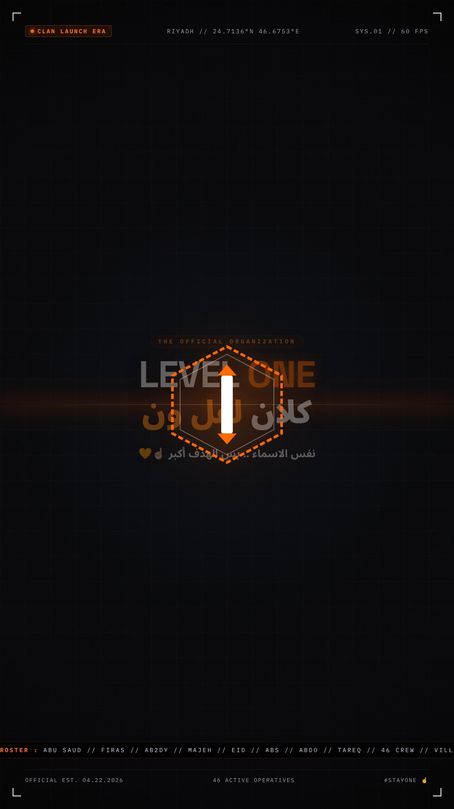
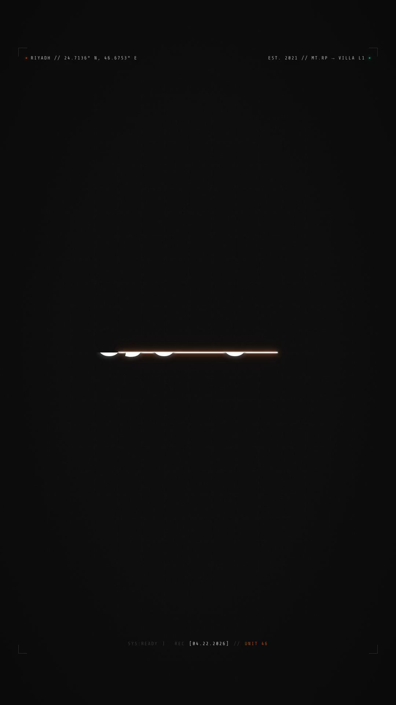
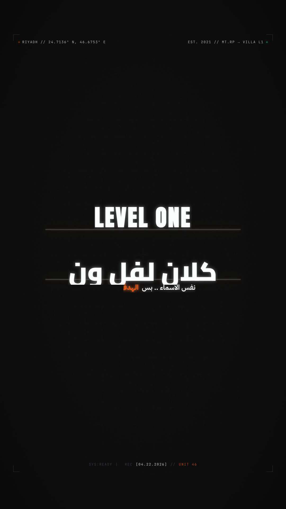
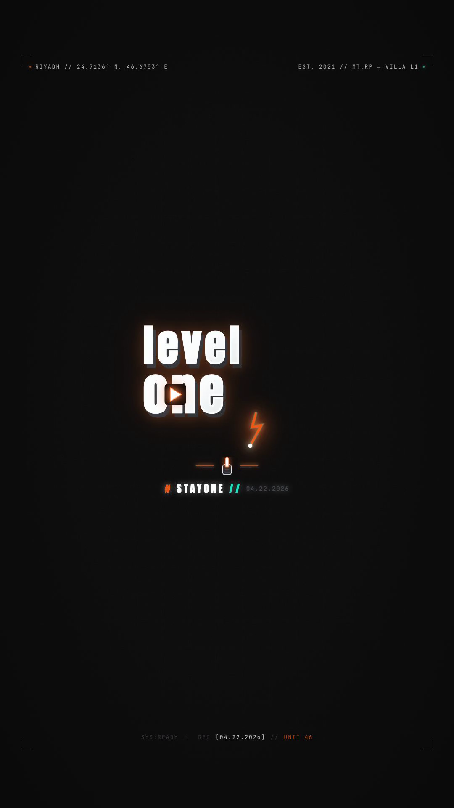

# Clan Level One (كلان لفل ون) — Official Motion Graphics Video Suite

> **"نفس الاسماء .. بس الهدف أكبر ☝🏼🧡"**  
> **Official Foundation Milestone: April 22, 2026** // [#StayOne ☝️](https://x.com/level_one/status/2047027920430846446)

This repository contains the complete motion graphics production codebase, creative direction, and dual rendering engines for **Clan Level One**:

1. **HyperFrames Engine (`/hyperframes`):**
   - High-performance, agent-native HTML5 + CSS + GSAP 3 animation pipeline.
   - Deterministic 60 fps rendering via headless browser and FFmpeg.
   - Synchronized with *21 Savage — redrum* acoustic architecture.

2. **Remotion Engine (`/remotion`):**
   - React + TypeScript componentized architecture.
   - Custom spring physics (`LevelOneLogo`, `LevelOneTelemetry`, `LevelOneStayOne`, `LevelOneBackground`).
   - Cloud Matrix 20-worker parallel rendering workflow (`.github/workflows/remotion-render.yml`).

3. **Master Creative & Lore Documentation (`/docs`):**
   - [`docs/level_one_direction.md`](docs/level_one_direction.md): Master Creative Direction & Anti-Slop Bible.
   - [`docs/clan_level_one_dossier.md`](docs/clan_level_one_dossier.md): Clan history, April 2026 founding, 46-member roster, Riyadh Villa lore.
   - [`docs/music_selection.md`](docs/music_selection.md): Soundtrack analysis and acoustic cues.

---

## Cloud Rendering on GitHub Actions

Both engines render 100% remotely via GitHub Actions runners with automated asset caching, chunk matrix parallelization, and FFmpeg audio muxing:

- **HyperFrames Pipeline ([`.github/workflows/hyperframes-render.yml`](.github/workflows/hyperframes-render.yml)):**
  - **Render Time:** **45 seconds** end-to-end on a single standard Ubuntu runner.
  - **Output:** `clan_level_one_hyperframes.mp4` (1080×1920 portrait @ 30 fps, H.264, 48 kHz stereo AAC).
  - **Verified Run:** [Run #44516324676](https://github.com/KNIGHTABDO/clan-level-one-motion/actions/runs/44516324676)

- **Remotion Matrix Pipeline ([`.github/workflows/remotion-render.yml`](.github/workflows/remotion-render.yml)):**
  - **Render Time:** **~1m 40s** total (10 concurrent runners render 27 frames each in parallel, followed by a 46s stitcher & audio mux job).
  - **Output:** `clan_level_one_remotion_master.mp4` (1080×1920 portrait @ 60 fps, H.264, 48 kHz stereo AAC).
  - **Verified Run:** [Run #44516769365](https://github.com/KNIGHTABDO/clan-level-one-motion/actions/runs/44516769365)

---

## Render Stills & Visual Comparison

### 1. HyperFrames Render (GSAP 3 + Clean Modern Web Typography)
| $t = 0.5\text{s}$ (Impact Flash & Coordinate Grid) | $t = 2.0\text{s}$ (Roster HUD & Arabic Type) | $t = 3.5\text{s}$ (Official Milestone Stamp) |
| :---: | :---: | :---: |
|  |  |  |

### 2. Remotion Render (Spring Physics + Procedural Atmospheric Mesh)
| $t = 0.5\text{s}$ (Chromatic Glitch Flash) | $t = 2.0\text{s}$ (Telemetry Readout & Micro-HUD) | $t = 3.5\text{s}$ (Outro Monolith & Core Branding) |
| :---: | :---: | :---: |
|  |  |  |

---

## Technical Comparison: HyperFrames vs Remotion

| Feature | HyperFrames (`/hyperframes`) | Remotion (`/remotion`) |
| :--- | :--- | :--- |
| **Animation Paradigm** | GSAP 3 deterministic timeline (`window.__timelines["main"]`) | React component lifecycle (`useCurrentFrame`, `interpolate`, `spring`) |
| **Build System** | Agent-native pure HTML/CSS/JS (Zero Webpack / Zero Babel) | Webpack 5 + TypeScript + React bundling |
| **Cloud Render Speed** | **45 seconds** (Single Ubuntu Runner) | **~100 seconds** (10 parallel chunks + stitch job) |
| **Code Size** | ~15 KB code (`index.html`) | Multi-component TSX bundle (~120 KB + node_modules) |
| **Motion Physics** | Custom Bezier easings (`power4.out`, `expo.inOut`, `circ.out`) | Real-time spring physics (`damping: 12`, `stiffness: 180`) |
| **Typography** | Direct CSS `@font-face` with dynamic glyph bounding | Remotion font loader |

